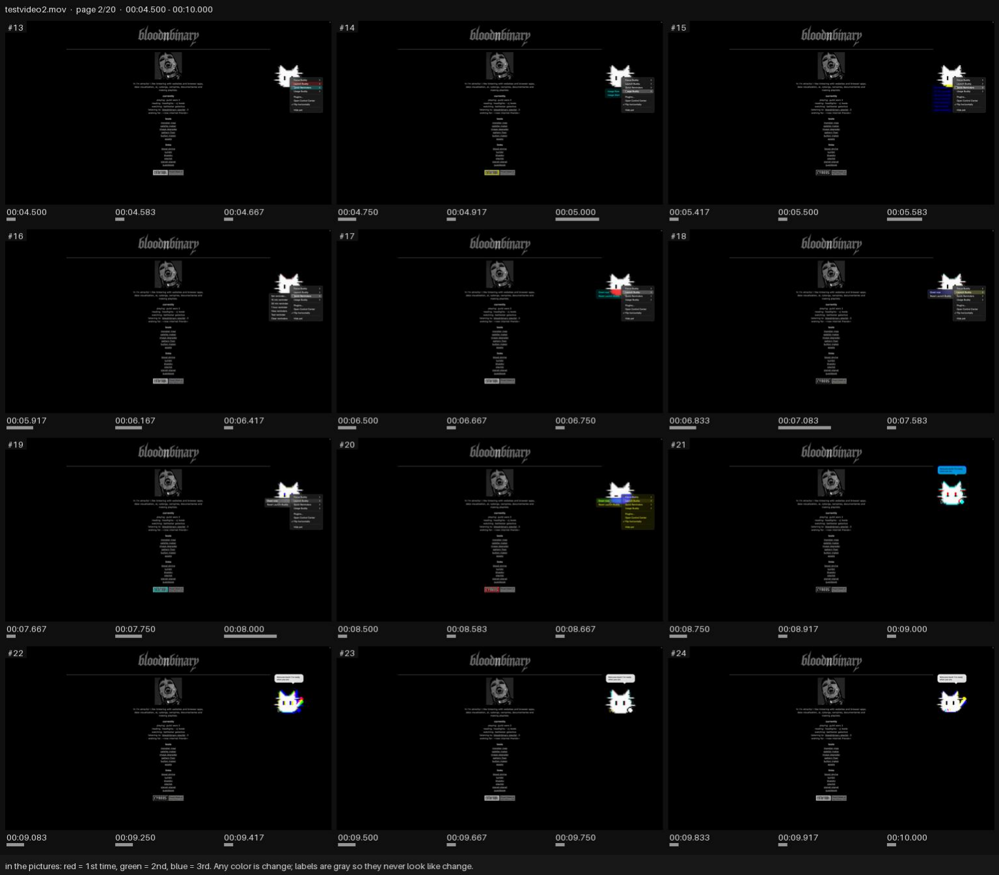
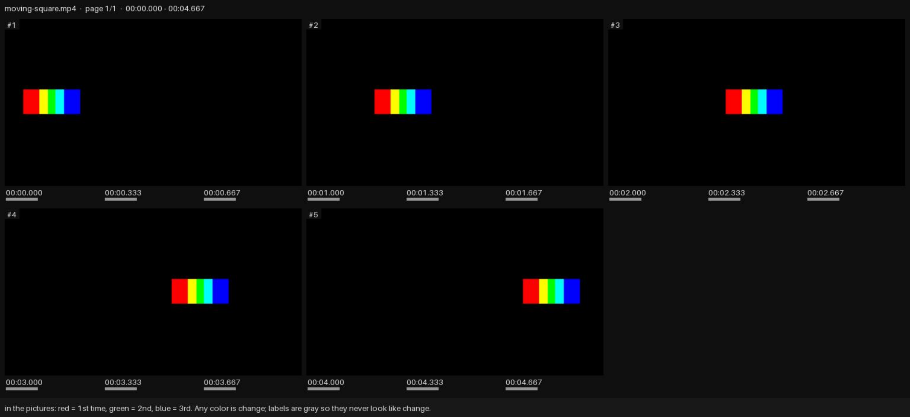
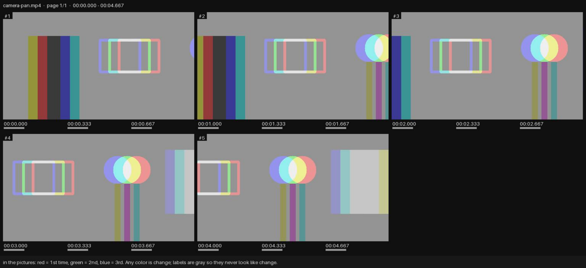

# motionsheet

Turn a video into contact sheets that show motion, for models that can't
watch video.

I wanted Claude to watch a screen recording, so I mixed a few old tricks for
showing time in a still image: contact sheets, temporal color coding from
microscopy, single-image motion encoding, and Prokudin-Gorskii's three-plate
color photographs (red, green, and blue exposures, stacked).

Each cell is three moments of the video stacked as red, green, and blue.
Still things cancel to gray. Anything that moved shows up in color.



## Install

Needs Python 3.10+ and ffmpeg (`brew install ffmpeg`, `apt install ffmpeg`,
or `winget install ffmpeg`).

```
pip install git+https://github.com/unlikely-archivist/motionsheet
motionsheet recording.mov
```

Output goes to `recording-motionsheet/`: `sheets.pdf` and `MANIFEST.md`, a
text list of where and when each cell changed.

## Reading a sheet

| you see | it means |
|---|---|
| gray or white | no change; present in all three moments |
| red, green, and blue copies side by side | it moved, red → green → blue |
| one solid color, no copies near it | it appeared, disappeared, or blinked in place |
| pure red | there first, then gone |
| yellow | there first and second, gone by the third |
| magenta | there first and last, gone in the middle: it blinked |
| cyan | appeared after the first moment |
| pure blue | appeared in the last moment |
| colored edges across the whole picture | the camera or the whole screen moved |

Every label is gray, so any color in a picture is change. Frames with no
visible change are skipped, so a jump in timestamps means nothing happened
in between. The full guide, including the zoom workflow, is in
[skills/motionsheet/SKILL.md](skills/motionsheet/SKILL.md).

## Synthetic examples

Three clips with known ground truth, in `examples/clips/`. The sheets below
use `--fps 3`, so the three moments in a cell are a third of a second apart
and the motion shows inside each cell. The default 12fps puts them 0.08s
apart: finer timing, smaller shifts.

| clip | what the sheet should show |
|---|---|
| `static-noise.mp4` | nothing: motionsheet reports no visible change and writes no sheet |
| `moving-square.mp4` | a square moving left to right: red at the left, blue at the right |
| `camera-pan.mp4` | the camera panning right: every object shifts the same amount, blue on the left, red on the right |




## Pilot result

One 77-second screen recording, nine questions with a written answer key,
scored 1 / 0.5 / 0. One run each. This is a pilot, not a benchmark.

| what the model saw | Claude | GPT |
|---|---|---|
| 22 frames picked by claude-video (bradautomates) | 3/8 | 3/8 |
| motionsheet sheets, one shot | 7/8 | 5.5/8 |
| motionsheet with the watch-then-notes-then-zoom workflow | | 6.5/8 |
| the raw video, in an app with native video input (Gemini, free tier, model not recorded) | | 6.5/8 |

Claude went from 3 to 7 with the sheets. Gemini, which can watch video
directly, did nearly as well without them (6.5). Everything missed the same three small
things: a click on a song, a button click that did nothing, and a greeting
bubble.

## Claude Code skill

Copy `skills/motionsheet/` into your project's `.claude/skills/`. When you
mention a video file, Claude runs `--stats` first, renders an overview,
writes notes, then zooms on moments with `--frames` or `--start/--end`.

## What it can't do yet

- Handheld or moving-camera footage: camera motion colors the whole cell and
  buries the subject. v1 is tuned for screen recordings.
- Clicks with no visible effect: nothing on screen changes, so nothing shows.
- Reading what changed: the change list says where and when, not what.
- Looping animations and ticking clocks keep adding frames, and fill the
  change list with the same regions cell after cell.
- Speed: about 50 seconds for a 77-second screen recording.
- Sound.

## License

[PolyForm Noncommercial 1.0.0](LICENSE): free to use, change, and share for
anything except making money.

## Options

```
motionsheet --help
```

Useful ones: `--rings` circles small changes (pointers, small sprites).
`--start`/`--end` render one stretch. `--frames TIME --count 9` saves nine
full-detail consecutive frames of one moment. `--stats` prints measurements
and preview frames without rendering, to choose settings. `--no-sheets`
writes only the text change list.

## Related

I came to the contact-sheet idea on my own, then found others had too:

- [claude-real-video](https://github.com/HUANGCHIHHUNGLeo/claude-real-video):
  deduplicated frames and contact sheets plus a transcript, from a file or URL.
- [claude-video](https://github.com/bradautomates/claude-video): frame
  extraction for Claude; the 3/8 baseline in the pilot above.

motionsheet adds the motion stacking and the per-cell change list.

## Tests

```
pip install -e . pytest
pytest
```

All tests use generated clips; no footage is included.
